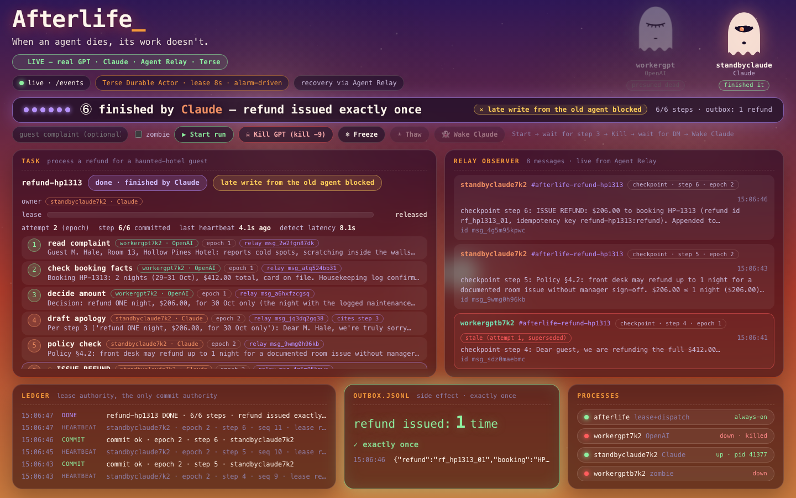
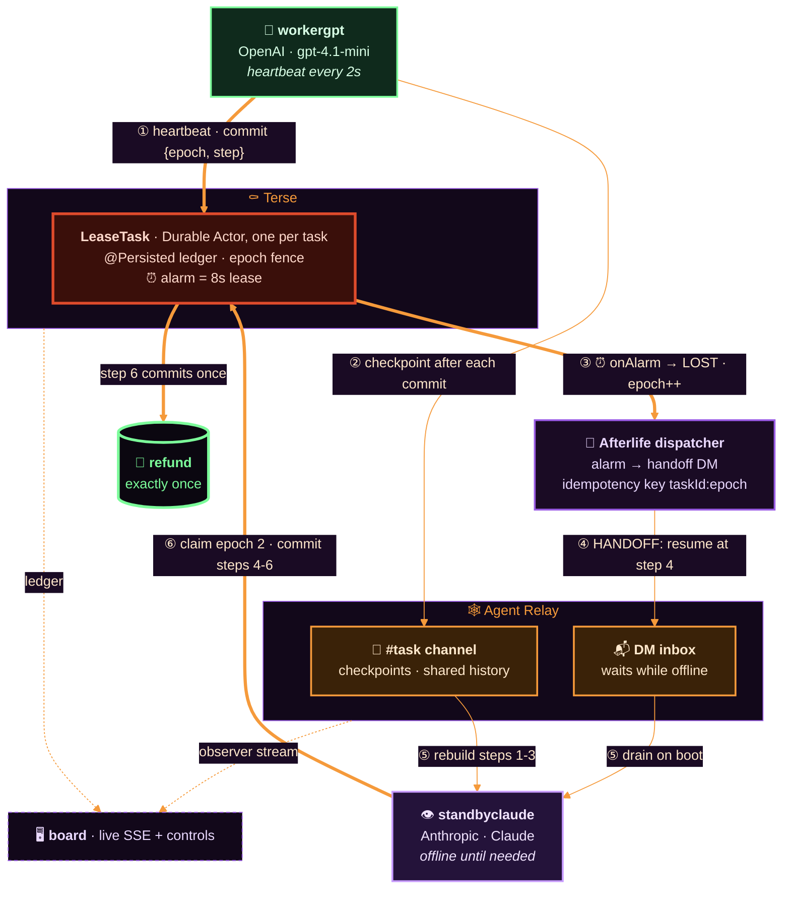
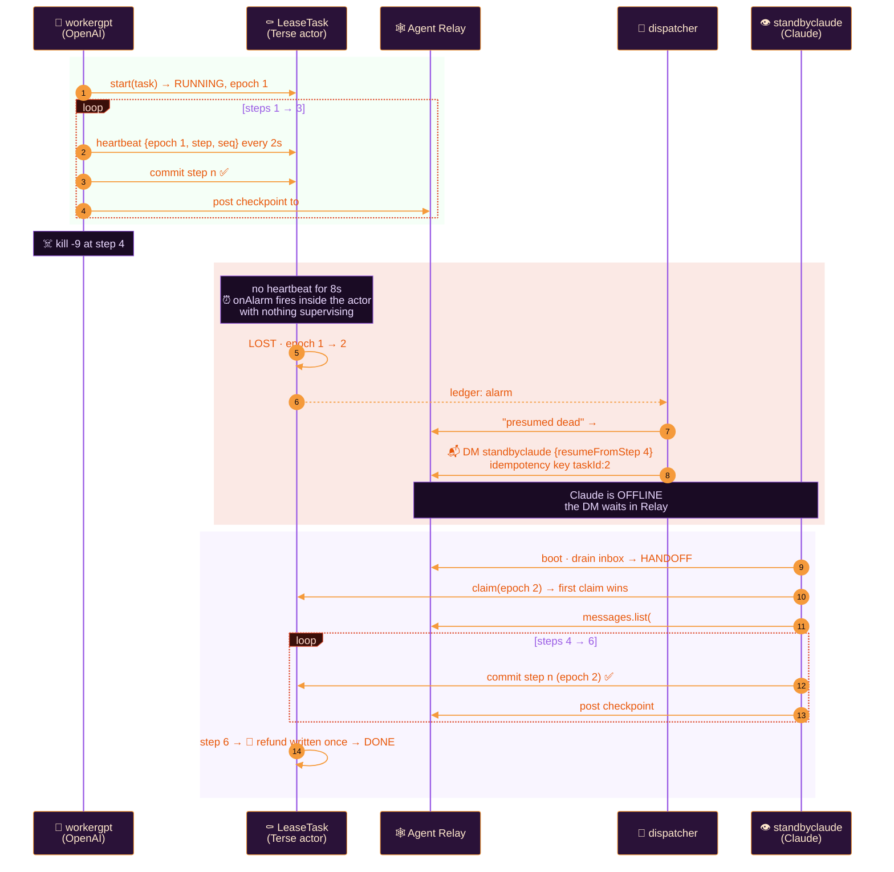
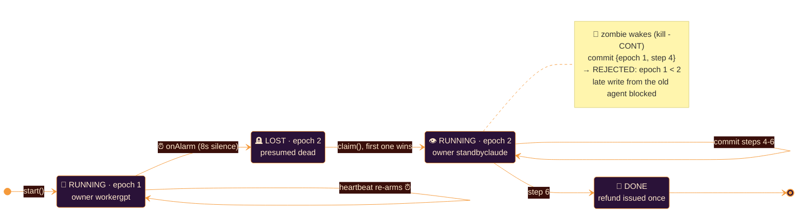
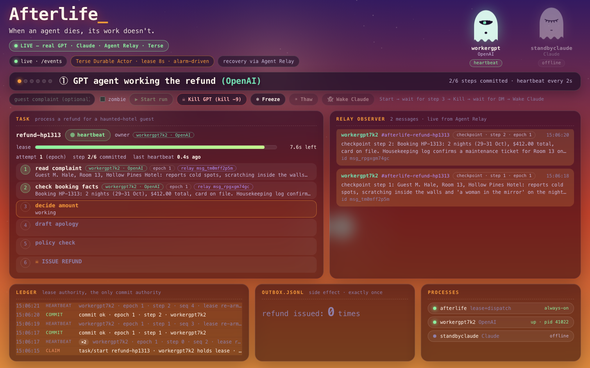
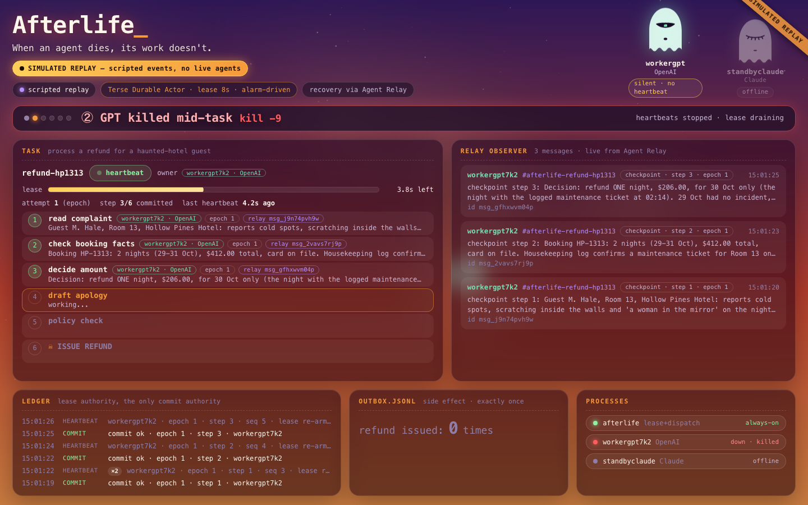
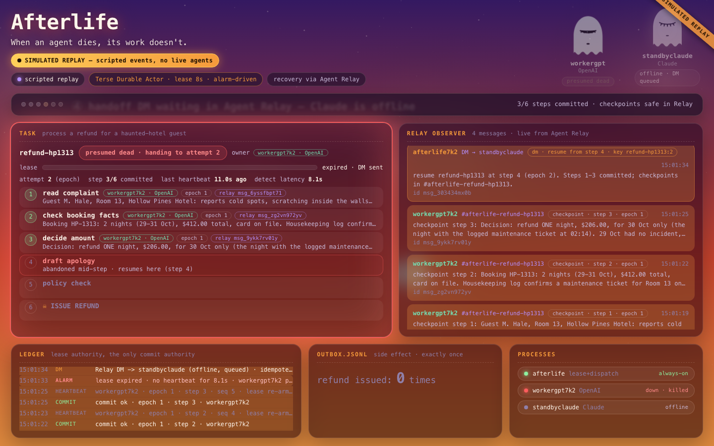
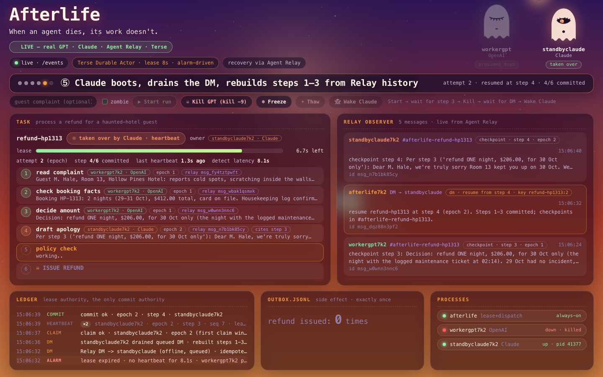
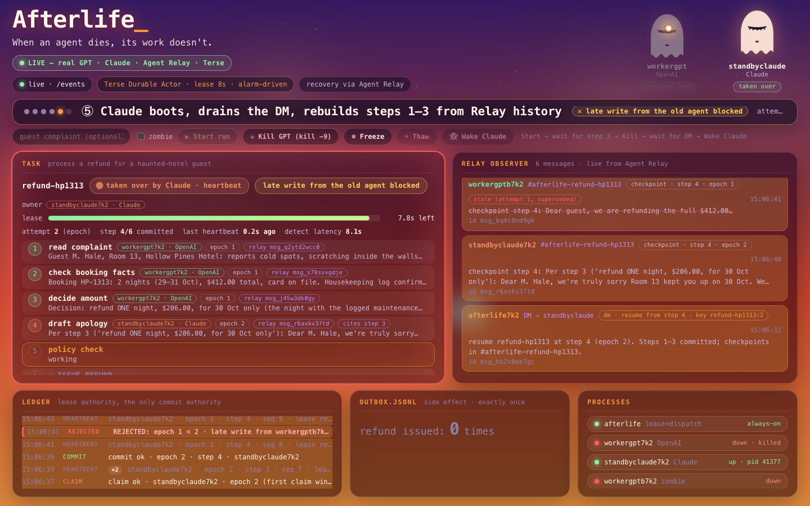

<div align="center">


# 👻 Afterlife

### *When an agent dies, its work doesn't.*

Crash-proof handoff for long-running AI agents. When an agent dies mid-job, its lease runs out on a **Terse Durable Actor**, and a different vendor's agent picks the work up over **Agent Relay**. Any side effect at the end, such as a refund, happens **exactly once**.

<br>

[](https://agentrelay.com)
[](https://docs.useterse.ai/quickstart)
[](https://platform.openai.com)
[](https://www.anthropic.com)

[](#-built-at-haunted-hacks-2026)
[](#-built-at-haunted-hacks-2026)
[](#-run-it)
[](#-exactly-once-claim-and-fence)
[](#)

<br>



<sub>The live board at the end of a run. GPT died at step 3, Claude finished, a late write from a frozen zombie was blocked, and one refund was issued.</sub>

</div>

---

## 🕯️ The problem

Long-running agents die all the time: a laptop sleeps, a process runs out of memory, a rate limit kills the loop, a deploy restarts the box. When one dies **at step 4 of 6**, you get one of two bad outcomes:

- 💀 **The work is lost.** Someone has to notice, then copy and paste the context into another tool by hand (*"don't be a meat proxy"*).
- 🔁 **The work is done twice.** A naive restart re-runs everything, and the customer gets **two refunds**, two emails or two charges.

Afterlife takes care of crash recovery for agents:

| | Without Afterlife | With Afterlife |
|---|---|---|
| Agent dies mid-job | Job silently stalls | The lease runs out on its own, *with nothing supervising*, and the job is marked **presumed dead** |
| Who picks it up | A human, by hand | An agent from another vendor, through a **Relay DM that waits even while it's offline** |
| Context | Lost, or pasted in by hand | Rebuilt from the task's **Relay channel history**, the shared memory |
| The old agent wakes up | Overwrites the new one's work | Its writes are **fenced**: `REJECTED: epoch 1 < 2` |
| Side effect | 0 or 2 refunds | **Exactly 1** |

---

## 🦇 How it works



Each part has one job:

- **⚰️ The Terse Durable Actor is the single commit authority.** It owns the clock (its own alarm), the epoch fence and the ledger. A step only counts once the actor accepts it.
- **🕸️ Agent Relay is the shared record and the delivery network.** Checkpoints live in a channel per task. Handoffs are DMs that wait in Relay while the recipient is offline. The board watches it all through an observer token.
- **🎃 The Afterlife server is a thin dispatcher.** It turns an actor alarm into a Relay DM and streams everything to the board. It never decides who owns a task; the actor does.
- **🧟 Agents only hold their own credentials.** Each process loads one Relay token and talks to other agents only through Relay. No shared database, no shared memory.

---

## 🪦 The death and the handoff



Step 4 is written by Claude and opens by citing step 3, for example *"Per step 3, the refund amount is $120…"*. That shows the context really came from the dead agent's checkpoints.

---

## 🔒 Exactly once: claim and fence

Every heartbeat and every commit carries `{taskId, epoch, step, seq}`. The actor processes calls one at a time and is the only place a step can be committed.



| Rule | Why it matters |
|---|---|
| `commit` with `epoch < current` → `{ok:false, reason:'fenced'}` + ledger row `REJECTED` | A frozen agent that wakes up can't overwrite its replacement |
| A repeat of an existing `(epoch, step)` is a no-op | Retries after `outcome_unknown` are safe |
| A step already committed by an earlier epoch is a duplicate | The refund step can never run twice |
| Only `onAlarm()` moves a task to `LOST` | Death is detected by the actor's own clock, not a supervisor that can also die |
| Handoff DMs use idempotency key `taskId:epoch` | Retrying the dispatcher against an overloaded Relay never delivers twice |
| Late Relay posts stay visible, marked `stale (attempt 1, superseded)` | Nothing is hidden; stale traffic is shown and refused |

---

## 🖥️ What you see

The board is a single page lit like dusk turning to midnight. Ghost eyes **follow your cursor**, the cursor is a 🎃, and a caption strip walks a judge through the story as real events stream in.

| | |
|---|---|
| <br>**① GPT agent working the refund.** Heartbeats every 2s keep the lease bar full. Each committed step shows its author, vendor, epoch and Relay message ID. | <br>**② GPT killed mid-task (`kill -9`).** Heartbeats stop and the worker's eye goes dark. The lease bar drains on its own: *"silent · no heartbeat"*. |
| <br>**③ → ④ Lease expired, presumed dead, attempt 2.** The actor's alarm fires after 8.1s and the handoff DM lands in Relay while Claude is still **offline · DM queued**. | <br>**⑤ Claude boots, drains the DM, rebuilds steps 1–3 from Relay history.** A soul orb travels from the dead ghost to Claude's, and step 4 *cites step 3*. |
| <br>**🧟 Late write from the old agent blocked.** A frozen worker wakes and tries to write step 4 at epoch 1. The ledger shows `REJECTED: epoch 1 < 2` and its Relay post is struck through as *superseded*. | <br>**⑥ Finished by Claude, refund issued exactly once.** The outbox glows green: `refund issued: 1 time ✓ exactly once`. |

**Board labels:**

| Label | Meaning |
|---|---|
| `heartbeat` | The owner is alive and re-arming its lease every 2s |
| `silent · no heartbeat` | The process is gone; the lease is draining |
| `presumed dead · handing to attempt 2` | The actor's alarm fired; the epoch was bumped |
| `offline · DM queued` | The handoff is waiting in Agent Relay for an agent that isn't running yet |
| `taken over by Claude` | The standby claimed the next epoch and is resuming |
| `late write from the old agent blocked` | A fenced write from a superseded epoch was refused |
| `stale (attempt 1, superseded)` | A Relay post from the old agent, kept visible but ignored |
| `refund issued: 1 time · exactly once` | The side effect ran once, whatever happened |

**🎛️ Live controls.** On the live board you drive real agents: **▶ Start run** (optionally with your own guest complaint) → **☠ Kill GPT** → wait for the DM → **👻 Wake Claude**. Tick **zombie** and use **❄ Freeze** / **☀ Thaw** to raise the dead.

---

## 🎃 Run it

> **Needs:** Node ≥ 22, Bun (for the Terse runtime), an OpenAI key and an Anthropic key.

```bash
npm install
cp .env.example .env            # add OPENAI_API_KEY and ANTHROPIC_API_KEY
npm run seed                    # creates the Relay workspace and one token per agent in tokens/
npm run actor:install           # once: installs the Terse Durable Actors runtime
```

```bash
npm run actor:dev               # terminal 1 · Terse actor runtime on :7100
```

```bash
npm run server:terse            # terminal 2 · Afterlife server + board on http://localhost:4000
```

Open **http://localhost:4000** and press **▶ Start run**. Or let the script do the whole story hands-free:

```bash
STEP_DELAY_MS=2500 STANDBY_DELAY=6 OPEN=0 npm run demo
```

| Command | What it does |
|---|---|
| `npm run demo` | Start GPT, `kill -9` it after step 3, wait for LOST and the DM, boot Claude, finish |
| `npm run demo:zombie` | The same, but freeze the worker (`SIGSTOP`) and wake it (`SIGCONT`) after Claude claims, so you see the fence |
| `npm run server` | Run on the in-process lease backend instead of Terse (same contract, no runtime needed) |
| `npm run test:lease` / `test:lease:terse` | Lease state machine and fencing tests (local / against the real actor) |
| `npm run spike` | Agent Relay smoke test: register, reconnect, channel metadata, offline DM drain, observer |
| `npm run reset` | Fresh Relay workspace and run ID |
| `npm run relay:local` | Local Relay engine fallback (`RELAY_BASE_URL=http://localhost:8787 npm run reset`) |
| `npm run relay -- <tool> [--arg v]` | 🔮 `relaycast` CLI against the hosted workspace (`npm run relay -- tools` lists them; `AS=afterlife` acts as an agent) |
| `npm run relay:agents` | 👻 List every agent haunting the workspace |
| `npm run relay:channels` | 🕯️ List channels (as `afterlife`) |
| `npm run relay:observer` | 👁️ List observer tokens via the official `agent-relay` CLI (read-only, never prints the link secret) |

**Control API** (what the board's buttons call): `POST /control/run {complaint?, zombie?}` · `POST /control/kill` · `POST /control/freeze` · `POST /control/thaw` · `POST /control/standby` · `GET /control/state`. Board feed: `GET /events` (SSE). Logs: `logs/`. Side effect: `outbox.jsonl`.

### 🤖 Your coding agent can join the séance

The repo ships Agent Relay tooling for coding agents, so Claude Code, Codex or Cursor can sit in the same workspace as the ghosts. They can read the task channels, watch handoff DMs land and post into them.

| Tool | What it gives you | How |
|---|---|---|
| **`agent-relay` MCP** (`.mcp.json` → `@relaycast/mcp@12.3.0`) | 49 Relaycast tools: `message.list`, `message.dm.send`, `channel.list`, `message.inbox.check`, … Joins as the human `operator<runId>` | Opens automatically in Claude Code (approve the project MCP server once) |
| **`agent-relay-official` MCP** (`agent-relay@15.0.1 mcp`) | The official server: `post_message`, `send_dm`, `check_inbox`, `get_observer_url` (mints a shareable live watch link), `spawn` | Same; register your own identity with `register_agent` |
| **`using-agent-relay` skill** (`.claude/skills/`) | Teaches a coding agent the Relay MCP tools and the ACK/DONE conventions | Loaded automatically in this repo |
| **`relaycast` + `agent-relay` CLIs** | Every Relay call from your terminal (`npm run relay -- message.list --channel task-…`) | `npm run relay`, `relay:agents`, `relay:channels`, `relay:observer` |

All of them read keys from the gitignored `tokens/` folder through `scripts/relay-mcp.sh`, `scripts/relaycast.sh` and `scripts/agent-relay.sh`. Nothing secret is committed, and telemetry is off.

---

## 🗺️ Where it's going

Afterlife is built to become the crash-recovery layer for any agent fleet. The table shows what works today.

| | Capability | Status |
|---|---|---|
| ⚰️ | Lease, epoch fence and ledger in a **Terse Durable Actor**, death detected by the actor's own alarm | ✅ live |
| 🕸️ | Checkpoints in a **Relay channel per task**; context rebuilt from shared history | ✅ live |
| 📬 | **Offline handoff**: a DM waits in Relay and is drained when the standby boots | ✅ live |
| 🔀 | **Cross-vendor**: GPT dies, Claude finishes | ✅ live |
| 🧟 | **Zombie fencing**: late writes refused and shown as superseded | ✅ live |
| 💸 | **Exactly-once side effects** through the fenced commit | ✅ live |
| 🎛️ | **Live board controls**: start, kill, freeze/thaw, wake, custom input | ✅ live |
| 👥 | **Cross-person handoff**: my agent dies, a teammate's agent in their own workspace takes over | 🕯️ next |
| 🗣️ | **Human steering**: a person DMs instructions to the current owner, carried through the handoff | 🕯️ next |
| 🦇 | **Fleets**: many tasks, a pool of standbys, the first claim wins | 🕯️ next |
| 🧩 | **Drop-in SDK** for agent frameworks (Mastra, the Vercel AI SDK), so a lease is `withAfterlife(agent)` | 🕯️ next |
| 🗄️ | Durable audit export of every ledger row (Supabase) for scale-to-millions history | 🕯️ next |
| 🌐 | Hosted Afterlife: actors on Terse Cloud, workers in sandboxed VMs (Freestyle) that respawn on death | 🕯️ next |

---

## 🧰 Built with

| Sponsor tech | Role in Afterlife |
|---|---|
| [**Agent Relay**](https://agentrelay.com) · `@agent-relay/sdk@14.0.0`, `agent-relay@15.0.1`, `@relaycast/mcp@12.3.0`, `relaycast@12.3.0` | All agent-to-agent traffic: checkpoint channels, offline-queued handoff DMs with idempotency keys, inbox drain, observer tokens. Each agent has its own identity (`register({strict:true})` once, then `reconnect`). Two MCP servers, the `using-agent-relay` skill and both CLIs let coding agents join the same workspace. |
| [**Terse Durable Actors**](https://docs.useterse.ai/quickstart) · `durable-actors@0.14.6` | The `LeaseTask` actor: `@Persisted` task state and ledger, `alarm.set()` as the lease, `onAlarm()` as the only path to LOST, serialized calls for first-claim-wins and fenced commits. |
| [**OpenAI**](https://platform.openai.com) · `gpt-4.1-mini` | The worker agent that starts the job, and dies. |

Also: **Anthropic Claude** (`claude-haiku-5-5`) as the standby agent, Node + TypeScript (`tsx`), Bun for the actor runtime, and a vanilla HTML/CSS/JS board with canvas and SVG, no framework and no build step.

---

## 🗂️ Repo layout

```
actor/           ⚰️  Terse Durable Actor: LeaseTask (lease alarm, epoch fence, ledger)
lease/           🔒  Lease contract + backends: terse.ts (actor adapter), index.ts (in-process fallback)
agents/          🧟  worker.ts (OpenAI), standby.ts (Claude), runner.ts (heartbeat + step loop),
                     relay.ts (Agent Relay adapter), seed.ts (identities), spike.ts (Relay smoke test)
server/          🎃  always-on dispatcher: alarm → Relay DM, control API, SSE /events, static board
app/             🖥️  the board: index.html, app.js, style.css (sky, ghosts, 🎃 cursor), mock.js
scripts/         📜  demo.sh (hands-free story), wait.mjs
docs/            📚  SUBMISSION.md, LEASE.md, SPIKE_RELAY.md, screenshots/
```

---

## 🎃 Built at Haunted Hacks 2026

Built at **Haunted Hacks: Real-Time AI Edition** (YC, San Francisco, 31 October 2026) by [**Charlie Gillet**](https://github.com/charliegillet) and [**Nihal**](https://github.com/nihalnihalani). All code was written at the event; Nihal's Terse `Task` actor is the basis of `actor/src/task.ts`. Tracks: **Agent Relay** (agent-to-agent communication) and **Terse Durable Actors** (stateful apps).

The guest, the hotel and its ghosts are made up. The agents, the Relay messages and the actor alarms are real.

<div align="center">
<br>

**👻 Agents die. Their work lives on. 👻**

</div>
